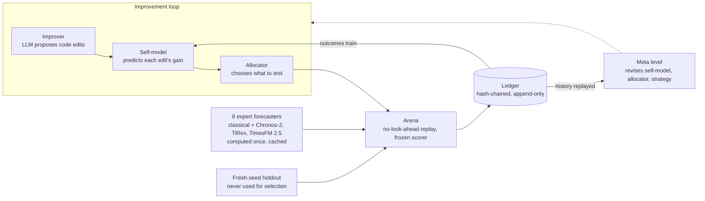

<div align="center">

# EvolveTS

**A self-improving time-series forecasting system that rewrites its own adaptation code, and predicts which of its changes are worth testing.**

[](https://github.com/kostagjorgjievski/evolve/actions/workflows/ci.yml)


</div>

---

## Overview

Forecasts fail when the world changes. After a *regime shift* (a sudden change in level, trend or seasonality) every forecaster, including large pretrained foundation models, keeps predicting the old behaviour, and errors peak when decisions matter most. The layer that decides how to react, the online *updater* that combines and corrects forecasts, is still designed and tuned by hand.

EvolveTS automates that layer and then improves the improvement process itself:

- An **LLM improver** proposes code edits to the updater.
- A **self-model** predicts the gain of each edit *before* it is tested, and logs the prediction first.
- An **allocator** spends a fixed evaluation budget on the most promising edits.
- A **frozen arena** scores edits by replaying history with no look-ahead, and fresh-seed **holdout** data judges every edit the system keeps.
- An **append-only, hash-chained ledger** records every prompt, response, prediction and result, so every reported number can be regenerated from the ledger plus a git commit.

The research claim: using self-predictions to allocate effort improves capability per unit of compute faster than testing everything, or than standard search (bandits, Bayesian optimisation), at equal budgets.

EvolveTS is the self-evolution component of TimeSeries Code (TSCode), developed at Tsinghua University.

## How it works



The system runs three nested loops at three speeds:

| Loop | Speed | What it changes |
|---|---|---|
| **Updater** | every time step | Its own state inside one series: expert weights, bias and break estimates. It may output a corrected forecast, not only a blend. |
| **Improver** | every few minutes | The updater's *code*, judged across many series |
| **Meta level** | across whole runs | The self-model, the allocator and the improver's strategy, revised by replaying the ledger |

All expert forecasts are computed once on GPUs and cached, so evaluating a new idea replays stored predictions instead of re-running models. One full evaluation over 100 series takes about 2.7 minutes. This follows the replay-as-simulator idea of [Dream-RSI](https://arxiv.org/abs/2609.14858).

## Results so far

Three experiments decided where the system should work. Full write-ups are in [`docs/results/`](docs/results/).

**1. Combining foundation models with tuned classical rules adds almost nothing over the best single foundation model.** With the three foundation models in the expert pool, tuned Hedge and Fixed-Share land within 1% of the best single foundation model on ETTh1, ECL and synthetic data (development-set MASE 0.813 vs 0.815, 0.684 vs 0.689, 0.777 vs 0.777; the ETTh1 and ECL numbers are leakage-risk, since a foundation model may have seen these datasets in pretraining). On the classical pool alone the tuned rules are far behind (ETTh1 0.925, ECL 0.920). [Report](docs/results/gate1-dev-first-run.md)

**2. Learning better weights is saturated.** Two learned updaters (a constrained ridge stacker and a loss-predicting gate) beat the tuned baseline in 1 of 12 comparisons, by 0.4%. [Report](docs/results/gate1-learned-probe.md)

**3. Headroom grows with regime-shift severity.** Gap between the best tuned method and the true forecast, with all eight experts available:

| Benchmark | Sudden changes | Headroom to true forecast | Best switching oracle (8 switches) |
|---|---|---|---|
| `synthetic-dev` | none | 7.0% | 3.8% |
| `synthetic-shift1` | mild | 14.1% | 4.6% |
| `synthetic-shift2` | moderate | 22.2% | 5.8% |
| `synthetic-shift3` | severe | **34.7%** | 7.5% [6.4, 9.0] |

Choosing among experts recovers only a small part of the gap: after a break every expert is wrong in the same direction. Updaters are therefore allowed to output their own corrected forecast (`forecast-v2` interface, arena version 4), with weights-only updaters kept as a baseline. [Report](docs/results/headroom-scan.md)

## Engineering for trustworthy self-improvement

A system that sees its own scores learns to game them, so the measurement layer is built to resist it:

- **No look-ahead.** The arena owns the clock and releases a target only after its full forecast horizon has passed.
- **Frozen verifier.** Agent-editable packages cannot import the arena's sealed or live pools; [import-linter](https://github.com/seddonym/import-linter) enforces this in CI.
- **Predictions before evaluation.** Self-model predictions are written and flushed to the ledger before the evaluation they predict starts.
- **Append-only ledger.** Canonical JSON, a hash chain and a content-addressed blob store; `evolvets ledger verify` checks a whole run.
- **Reproducible LLM runs.** Every prompt and response is stored, so a lineage re-runs from recorded responses with no API calls.
- **Sandboxed candidates.** Proposed code passes a grammar validator and runs in a subprocess under a wall-clock deadline and a memory cap.
- **Equal budgets.** Every condition is charged LLM tokens, wall-clock time and evaluation counts through one accounting.

## Built by an agent team

The codebase is developed by AI agents working through GitHub, with a human owner setting direction:

```
Owner (direction, research gates) → Planner agent (task specs) → Developer agent (small PRs)
      → CI (ruff, mypy, import-linter, pytest) → Reviewer agent (independent agent) → squash-merge
```

Agents coordinate only through pull requests, issues and comment markers. They cannot edit the verifier, the CI rules or their own operating procedures. Long GPU jobs run on self-hosted lab runners. The project has 120+ merged pull requests; see [`docs/AGENT_LOOP.md`](docs/AGENT_LOOP.md) and [`AGENTS.md`](AGENTS.md).

## Roadmap

Levels follow [The Last AI Built by Humans](https://arxiv.org/abs/2609.11873).

| Level | Capability | Status |
|---|---|---|
| L1 | Instrument: arena, ledger, experts, baselines, headroom scan | ✅ Done |
| L2 | Improver + self-model + allocator loop, with rival allocators at equal budget | 🚧 Components merged; lineage runner and pilot in progress |
| L5 | Meta level revises the self-model, the allocator and the improver's strategy from ledger replay | Planned |
| L3 | Practice-world generator targeting the updater's failures | Planned |
| L4 | Live loop: public timestamped forecasts on live feeds | Planned |

Details are in [`docs/ROADMAP.md`](docs/ROADMAP.md).

## Repository layout

All packages live under [`src/evolvets/`](src/evolvets/); the paths below are relative to it.

| Package | Role |
|---|---|
| `arena/` | No-look-ahead replay, label release, synthetic generator and presets, dev/sealed/live pools, metrics |
| `cache/`, `experts/`, `foundation/` | Expert forecasters (5 classical, 3 foundation models) and their cached predictions |
| `updater/` | The object being improved: `weights-v1` and `forecast-v2` updaters and hand-designed baselines |
| `improver/` | LLM client, prompts, artifact validator, proposers, recorded-response replay |
| `selfmodel/` | Conformal ridge self-model with per-proposal gain quantiles |
| `allocator/` | Prediction-guided allocator and rivals (fixed, random, bandit, BO, evaluate-everything) |
| `ledger/` | Hash-chained append-only records and blob store |
| `runner/` | `evolvets` CLI: data, cache, foundation, arena, gate1, phase1 |

## Quick start

Requires Python 3.11+ and [uv](https://docs.astral.sh/uv/).

```bash
git clone https://github.com/kostagjorgjievski/evolve.git && cd evolve
uv sync --all-groups
uv run pre-commit install

# Quality gates (the same as CI)
uv run ruff check . && uv run ruff format --check . && uv run mypy && uv run lint-imports && uv run pytest

# Explore the CLI
uv run evolvets --help
uv run evolvets cache build synthetic-dev --per-family 2 --cache-root cache_store --data-root data
uv run evolvets arena oracle --help
```

Foundation-model caches need a GPU and an optional dependency group (`fm-chronos`, `fm-tirex`, `fm-timesfm`); see [`scripts/gpu-runner/`](scripts/gpu-runner/).

## Author

**Kosta Gjorgjievski**, Tsinghua University (MS, Computer Science) · UCLA (BS, Computer Science) · [GitHub](https://github.com/kostagjorgjievski)
